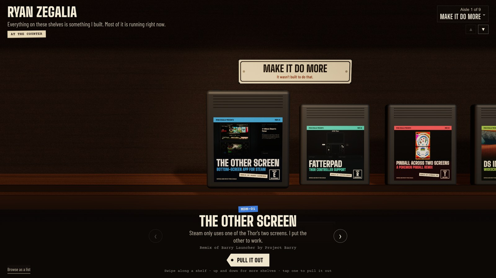

# The Shelf

The source for [ryanzegalia.com](https://ryanzegalia.com), Ryan Zegalia's portfolio presented as a store full of physical media.



## How it works

- Each shelf groups a kind of work and gives it a different medium: cartridges, cassettes, vinyl, film, software boxes and more. Pull a case out, turn it over and open the insert for the project story and proof.
- Covers, printed inserts and studio lighting can be baked ahead of time. If the bake is unavailable, surfaces are drawn in the browser instead.
- The 3D scene renders on demand. Interaction and animation wake it up rather than keeping an idle render loop running.
- A text version keeps the projects available when WebGL fails or cannot start. The visitor gets a usable portfolio instead of a black screen.
- First-party telemetry records visits and project interactions without cookies. It is not anonymous: the optional backend stores IP addresses and user agents, classifies traffic and applies a 365-day retention period. The viewer is access-controlled; credentials are never shipped in the frontend.

## Stack

React, Vite, Three.js, React Three Fiber and Drei for the interface. Node.js scripts validate content and optionally bake artwork through Chrome. The separate telemetry service uses Python, FastAPI, SQLAlchemy and PostgreSQL, with SQLite for tests.

## Run locally

Use a current Node.js release supported by Vite, such as Node 22.12 or later.

```sh
npm ci
npm run check
npm run dev
```

Open http://127.0.0.1:4870. Project content and images are included. Historical project statistics are frozen snapshots; private repository locations and collection scripts are not distributed.

```sh
npx vite build
npm run preview
```

That builds without a browser bake. For baked textures, install `playwright-core` locally and set `CHROME_PATH` to your Chrome executable, then run `npm run build`. The bake is optional and falls back to browser-drawn surfaces if Chrome or Playwright is missing. Generated textures and `dist/` are not committed.

## Optional telemetry service

The site runs without telemetry. For the backend, use Python 3.11 or later and a virtual environment.

```sh
cd telemetry
python -m venv .venv
. .venv/bin/activate
python -m pip install -r requirements.txt
NETINFO_OFFLINE=true python -m pytest -q
```

For a deployment, configure `DATABASE_URL`, `TRAFFIC_TOKEN`, `ALLOWED_ORIGINS` and `DATA_DIR` in your process environment. Set `HOME_IP` or `OWN_IPS` if you want to exclude your own traffic; neither contains a preset home address. `NETINFO_OFFLINE` disables network enrichment during testing. Network enrichment otherwise downloads public ASN and geolocation databases and can detect the server's public address.

Run `uvicorn app:app --host 127.0.0.1 --port 8556 --no-proxy-headers --no-access-log` behind a reverse proxy. Only configure `TRUSTED_PROXIES` for proxies you control. The optional LAN viewer shortcut requires an explicit `TRAFFIC_LAN_HOST` and a private client address; leave it unset for token-only access. Alerts are disabled by default and require an explicit dispatcher URL and credentials. No deployment credentials or environment files are included. Review access controls, IP retention and your privacy notice before enabling telemetry on a public deployment.

## Layout

```text
content/projects/   Project stories, public photos and frozen statistics
src/               React interface, accessible fallback and telemetry client
src/three/         Media geometry, printed surfaces and scene rendering
public/            Site icon; generated baked textures go here
scripts/           Content checks, texture baker and rendering regression tests
telemetry/         Optional telemetry API, traffic viewer and Python tests
docs/store.jpg     Screenshot of the live store
```
